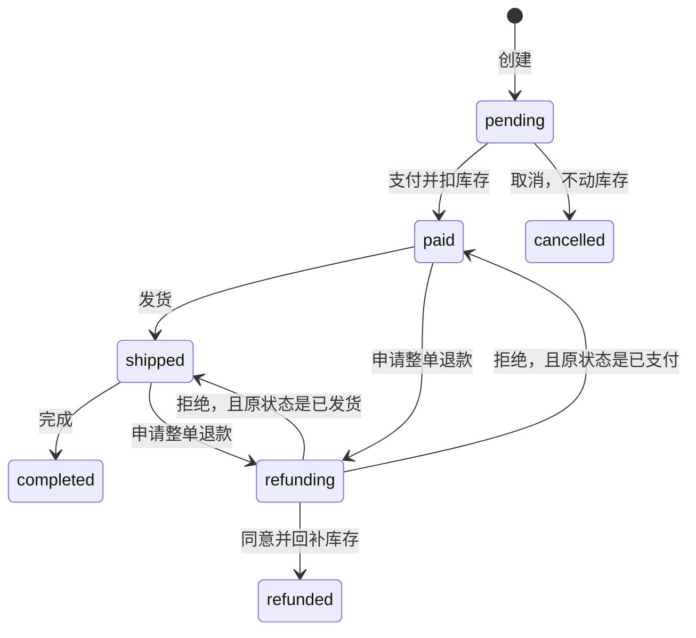

# 接口约定与示例

前端清单以 [README](../README.md) 为准。这里只展开 Go 实现时容易写错的几种协议。

统一前缀：`/api/v1`。WebSocket 不在这个前缀下。

## 响应信封

除文件流之外，所有 JSON 接口都用这个结构：

```json
{
  "code": 0,
  "message": "ok",
  "data": {},
  "traceId": "8f3c0b12ab34cd56"
}
```

`code = 0` 表示成功。失败时 HTTP 状态与 `code` 一起返回，`data` 为 `null`。

| code | HTTP | 含义 |
| --- | --- | --- |
| 0 | 200 | 成功 |
| 40000 | 400 | 请求不合法 |
| 40001 | 400 | 参数校验失败 |
| 40100 | 401 | 未登录或账号密码错误 |
| 40101 | 401 | Access Token 过期 |
| 40300 | 403 | 没有权限 |
| 40301 | 403 | 账号已禁用 |
| 40400 | 404 | 资源不存在 |
| 40900 | 409 | 乐观锁冲突 |
| 40901 | 409 | 状态机不允许该动作 |
| 40902 | 409 | 唯一约束或业务冲突 |
| 50000 | 500 | 未分类服务器错误 |

登录失败不要区分「用户不存在」和「密码错误」，统一 `40100 / 用户名或密码错误`。验证码错误用 `40001`。禁用账号本练习返回 `40301`，生产环境可以并进 `40100`。

分页：

```json
{ "list": [], "total": 128, "page": 1, "pageSize": 20 }
```

`page` 从 1 开始，`pageSize` 默认 10，最大 100。排序参数是 Ant Design 的 `sortField` + `sortOrder=ascend|descend`。

金额全部是**分**，整数。时间用 RFC3339。

文件下载、CSV 导出不走 JSON 信封，直接返回文件流，并带：

```http
Content-Type: text/csv;charset=utf-8
Content-Disposition: attachment; filename*=UTF-8''products.csv
```

CSV 建议带 UTF-8 BOM。出错时仍返回 JSON 信封。

## 认证

`GET /api/v1/auth/captcha`

```json
{ "captchaId": "uuid", "image": "data:image/svg+xml;charset=utf-8,..." }
```

验证码 2 分钟有效，一次一用。登录无论成功失败都作废。

`POST /api/v1/auth/login`

```json
{
  "username": "admin",
  "password": "admin123",
  "captchaId": "uuid",
  "captchaCode": "2468"
}
```

```json
{
  "accessToken": "access.1.1760000000",
  "refreshToken": "refresh.1.uuid",
  "expiresIn": 7200,
  "user": { "id": 1, "permissions": ["*"], "menus": [] }
}
```

Access Token 建议 2 小时，Refresh Token 建议 7 天。刷新时轮换：旧 refresh 立即失效，过期、被撤销或复用的旧 refresh 返回 HTTP 401 / `40100`。

`POST /api/v1/auth/logout` 的请求体为 `{ "refreshToken": "..." }`，以该 refresh 作为撤销凭证，不要求有效 Access Token，也不先自动续期。仅撤销这个 refresh；已撤销、过期或不存在的令牌重复退出均返回成功。这样不会出现「先轮换 refresh，退出却只撤销请求体里的旧 refresh」的问题。

改密码和管理员重置密码作废该用户全部 refresh；改密码页面随后主动退出。已有 Access Token 默认可用到过期，不能把撤销 refresh 等同于立即撤销所有 Access。

**账号禁用采用立即禁止访问的规则**：每次受保护请求和 refresh 都检查账号状态，禁用返回 HTTP 403 / `40301`，前端清会话回登录。普通 RBAC 权限不足返回 `40300`，只拒绝该请求，不退出登录。

请求头：

```http
Authorization: Bearer <accessToken>
```

### 前端续期与错误处理

- BE 必须使用上表中的 HTTP 状态，不能把 HTTP 401/403/500 都改为 200。Mock 与真实 HTTP 错误统一解析 `code/message/traceId`；文件流接口的 JSON 错误也会解析。
- 只有受保护请求的 `40101` 触发自动续期；`40100` 是未认证/凭证无效，直接回登录。登录、验证码、refresh、logout 不触发自动续期。
- 同一页面同时收到多个 `40101` 时合并为一次 refresh。成功后保存轮换结果，原请求各重放一次；迟到的旧 Access 请求复用已更新的令牌。重放仍然认证失败则退出，不能无限重试。
- 当前会话的自动续期返回 `40100/40101/40301` 时清会话。独立调用 refresh 验证旧令牌失败，不会误清当前新会话。
- 请求或 refresh 超时、断网、HTTP 500 时保留凭证，允许重试。页面初始化的会话恢复失败展示重试入口；只有 refresh 没有 access 时，先 refresh 再请求 me。
- 登录失效时保留内部 URL（含 query/hash），重新登录后回到该页面；外部地址和登录页自身不能作为回跳目标。
- 退出后尚未完成的旧续期结果不能重新写入登录凭证。
- 认证实践入口只在 Mock 模式制造本地故障，不增加 BE 接口。真实 BE 使用短有效期令牌、停服务等方式验证；不能修改 JWT 第三段来模拟过期，那会破坏签名。
- Mock 数据及 refresh/captcha 记录刷新页面即重置，各标签页独立；跨会话和持久化恢复场景接真实 BE。单页并发合并不等于跨标签页 refresh 协调。

详细操作清单见 [README 的认证场景](../README.md#认证必须练通的场景)。

## 游标分页

`GET /api/v1/audit-logs?limit=20&cursor=`

游标不透明。本练习按 `createdAt DESC, id DESC` 做 keyset：

```json
{ "list": [], "nextCursor": "base64", "hasMore": true }
```

解码后是 `{ "createdAt": "...", "id": 26 }`。下一页条件：

```text
createdAt < cursor.createdAt
OR (createdAt = cursor.createdAt AND id < cursor.id)
```

筛选条件变化后，客户端必须丢掉旧 cursor。

## 乐观锁

商品更新必须带当前 `version`。

```json
{
  "name": "机械键盘 84 键",
  "sku": "SKU-KB-84",
  "categoryId": 3,
  "price": 39900,
  "stock": 40,
  "status": "on",
  "description": "",
  "version": 3
}
```

`WHERE id = ? AND version = ?`，影响行数为 0 则返回 `40900`。成功后 version + 1。

`PATCH` 同样带 version，只更新出现的字段：`price`、`stock`、`status`、`description`。

订单不要再加一列 version。用状态条件更新：

```sql
UPDATE orders SET status = 'paid' WHERE id = ? AND status = 'pending'
```

影响行数为 0 就是 `40901`。

## 创建订单与幂等

```http
POST /api/v1/orders
Idempotency-Key: 6d0f0c3e-3c1a-4e0e-9d1a-6b4c2a9e8f10
```

```json
{
  "customerId": 1,
  "remark": "工作日送达",
  "items": [{ "productId": 1, "qty": 1 }]
}
```

同一个用户、同一个键、同样的请求体，24 小时内返回第一次创建的订单，并加响应头：

```http
Idempotency-Replayed: true
```

键相同但请求体不同，返回 `40902`。缺头返回 `40001`。

价格以下单时的商品价格做快照，之后改价不影响该订单。

## 订单状态机



规则：

- 只有 `pending` 能改明细，且至少留 1 行。
- 支付时按当前库存校验并扣减，和状态更新放在一个事务里。
- 未支付取消不扣库存，也不回补。
- 退款金额必须等于 `payAmount`，只做整单退。
- 同意退款后按明细数量回补库存。商品已删除则跳过回补。
- `feature.refundEnabled != true` 时拒绝新的退款申请。

## 分片上传

1. `POST /api/v1/files/uploads`

```json
{ "filename": "a.zip", "size": 1048576, "chunkSize": 262144, "mime": "application/zip", "bizType": "chunk" }
```

```json
{ "uploadId": "uuid", "chunkSize": 262144, "totalChunks": 4, "filename": "a.zip" }
```

2. `PUT /api/v1/files/uploads/{uploadId}/chunks/{index}`

Body 是原始字节，`Content-Type: application/octet-stream`。`index` 从 0 开始。同一片重复上传按覆盖处理，不要报错。

3. 片齐了再 `POST .../complete`，生成文件记录。缺片返回 `40902`。

4. `DELETE /api/v1/files/uploads/{uploadId}` 放弃任务。

普通上传是另一条路：`POST /api/v1/files/upload`，`multipart/form-data`，字段 `file` 和 `bizType`。商品图片不要进文件中心，走 `/products/:id/images`。

## WebSocket

```text
GET /ws/notifications?token=<accessToken>
```

浏览器不方便带 Authorization，所以用 query token。服务端帧：

```json
{ "type": "notification", "data": { "id": 1, "title": "", "content": "", "read": false } }
{ "type": "unread", "data": { "count": 3 } }
```

客户端每 30 秒：

```json
{ "type": "ping" }
```

服务端回 `{ "type": "pong" }`。

## 导入

商品 CSV 表头：

```csv
name,sku,categoryId,price,stock,status
示例耳机,SKU-DEMO-1,3,19900,20,on
```

`price` 是分。响应：

```json
{
  "total": 2,
  "success": 1,
  "failed": 1,
  "errors": [{ "row": 3, "message": "SKU 已存在" }]
}
```

`row` 是文件中的 1-based 行号，含表头。部分成功不要整批回滚，把错误行返回给前端。
